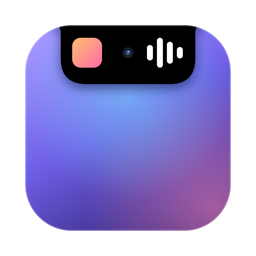
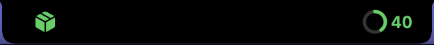
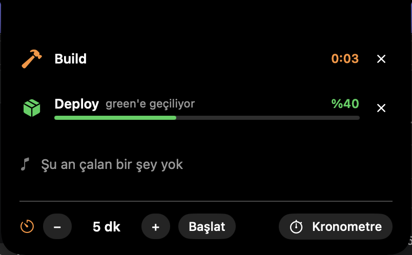

<p align="center"></p>

# NotchIsland

A small macOS app that turns the notch on a MacBook into a live status area, in the spirit of the Dynamic Island. It sits on the notch, opens wings on both sides when something is happening, and drops down into a panel when you point at it.





The interface text is currently in Turkish.

## What it shows

- **Now playing** from Music and Spotify: artwork, title, artist, a progress bar, and previous / play-pause / next buttons. A paused track stays on the island with a pause mark.
- **Apple TV, VLC and QuickTime Player**: title, progress and controls while they are running.
- **Media tabs in Safari, Chrome, Brave, Edge and Arc**: YouTube (videos and Shorts), YouTube Music, Twitch, SoundCloud and Netflix. Display only, no buttons.
- **Calls**: a green timer while Zoom, Teams, FaceTime, Webex or a Google Meet tab holds the microphone.
- **Your own activities**: scripts push a title, a detail line and a progress value with the `notch` command. Ready-made hooks for Claude Code and Xcode are in `integrations/`.
- **System figures** in the expanded panel: CPU, GPU, memory, free disk space and network speed.
- **Bambu Lab 3D prints**: job name, percentage, time left and layer, read from Bambu's cloud after `notch bambu-login`. The printer itself is never contacted.
- **Unread counts** for Mail, Messages, Slack, WhatsApp, Telegram, Teams, Discord and Outlook, read from their Dock badges.
- **Microphone and camera in use**: an orange or green dot, plus the name of the app holding the microphone.
- **Short notices**: volume changes, keyboard language switch, charger plugged or unplugged, low battery (20% and 10%), battery full, network lost or back.
- **Next calendar event and next reminder**: off by default; turn them on from the right-click menu.
- **Timer and stopwatch**: off by default; turn the row on from the right-click menu.
- **Volume keys** (optional): the app can take over the volume keys so the system's own volume display does not appear.

When several things are active, the right wing shows the most important one (your activity, then a call, the clock, the calendar, then music) and the left wing shows the icon of the next.

## Requirements

- macOS 14 or later
- A Swift toolchain (Xcode or the Xcode Command Line Tools)
- A Mac with a notch. On a screen without one, the app draws a pill at the top center instead.

## Build and run

```sh
git clone https://github.com/ozkomer/NotchIsland.git
cd NotchIsland
./build.sh --run
```

`build.sh` compiles the package, assembles `NotchIsland.app` next to the script, signs it ad hoc, and writes the `notch` command. `./build.sh --install` also copies the app to `/Applications` and starts it from there. Right-click the island for the switches (start at login, calendar, reminders, unread counts, volume keys, timer) and quit.

## The `notch` command

`build.sh` creates a `notch` script in the project folder. It talks to the running app, so the app has to be open.

```sh
# Show or update an activity. The id is yours to choose.
./notch show deploy "Deploy" --progress 40 --detail "switching to green" --icon shippingbox.fill --color green

# Finish it: a green check, or a red error.
./notch done deploy
./notch fail deploy "Failed"

# Remove it without a notice.
./notch clear deploy

# Run a command, show how long it has been running, and report how it ended.
./notch run "Build" -- npm run build
```

- `--progress` takes 0 to 100. Without it, the activity shows elapsed time.
- `--icon` takes an SF Symbols name.
- `--color` takes one of: green, red, orange, yellow, blue, cyan, purple, pink, white.
- `notch run` exits with the status of the command it ran.
- `notch bambu-login` signs in to a Bambu Lab account (password typed without echo, sent only to Bambu, not stored; the session token goes to the keychain). If Bambu's site turns the command away, `notch bambu-token` takes a token copied from the browser. `notch bambu-logout` removes it.

## Integrations

**Claude Code.** `integrations/claude-code/notch-hook.sh` shows each session as an activity: working, waiting for you, done. Add it to `~/.claude/settings.json`:

```json
{
  "hooks": {
    "UserPromptSubmit": [{ "hooks": [{ "type": "command", "command": "/path/to/notch-hook.sh working", "async": true }] }],
    "PostToolUse":      [{ "hooks": [{ "type": "command", "command": "/path/to/notch-hook.sh working", "async": true }] }],
    "Notification":     [{ "hooks": [{ "type": "command", "command": "/path/to/notch-hook.sh waiting", "async": true }] }],
    "Stop":             [{ "hooks": [{ "type": "command", "command": "/path/to/notch-hook.sh done", "async": true }] }],
    "SessionEnd":       [{ "hooks": [{ "type": "command", "command": "/path/to/notch-hook.sh end", "async": true }] }]
  }
}
```

**Xcode.** Run `integrations/xcode/make-links.sh` once, then in Xcode > Settings > Behaviors set "Run" for Build Starts, Succeeds and Fails to `notch-xcode-start.sh`, `notch-xcode-success.sh` and `notch-xcode-fail.sh`.

**Shortcuts and anything else.** Any tool that can run a shell command can call `notch`. Both scripts above expect the app in `/Applications`; set `NOTCH_BIN` to point elsewhere.

## Permissions

| Permission | When macOS asks | Used for |
|---|---|---|
| Automation: Music, Spotify, TV, VLC, QuickTime Player | When one of them is running | Reading the current item and sending play / pause / next |
| Automation: Safari, Chrome, Brave, Edge, Arc | When one of them is running | Reading tab addresses and titles to find a media tab |
| Accessibility | When unread counts or the volume key option is on | Reading the badge numbers on Dock icons; receiving the volume keys |
| Calendar, Reminders | When you turn on their switches | Reading the next event or reminder |

Everything else (microphone and camera indicators, calls, volume level, keyboard language, battery, network) uses public system properties and needs no permission. The app never records audio or video, never reads messages, and never runs anything inside a web page; it only reads whether a device is in use, the number on a Dock badge, and the address and title of tabs. The volume key option listens to media keys only, not to typing.

Because the app is signed ad hoc, macOS may ask for these permissions again after each rebuild. For Accessibility, remove the old NotchIsland entry (or run `tccutil reset Accessibility local.notchisland`) and add the new one.

## Limitations

- **Browser tabs: play state is inferred** from whether that browser is producing sound. If another tab makes sound while a media tab is open, the island shows the media tab as playing. With several media tabs, the first one found is shown. Firefox is not supported; it does not expose its tabs.
- **No system-wide "now playing".** Recent macOS versions do not let third-party apps read it, so each player needs its own support.
- **Wings cover menu bar items** that sit right next to the notch.
- **It does not show the system's own Live Activities.** It only shows what is listed above.
- Built and tried on one machine (a 14-inch MacBook Pro). Not yet tried at all: the Bambu Lab sign-in and print progress, Apple TV, VLC, QuickTime Player, Brave, Edge, Arc, calls, reminders and the Xcode scripts. Little tested: the battery, network, keyboard and calendar notices.

## How it works

A borderless panel is placed over the menu bar, centered on the notch. SwiftUI draws a black shape that matches the notch and animates between three sizes: idle, compact and expanded. The pointer position is polled, so the panel only takes mouse events while the pointer is over the island and clicks elsewhere pass through.

| File | Role |
|---|---|
| `main.swift` | Panel, pointer tracking, right-click menu, command line entry |
| `IslandModel.swift` | State and sizing |
| `IslandView.swift` | All drawing |
| `MusicController.swift` | Music and Spotify |
| `PlayerPoller.swift` | Apple TV, VLC, QuickTime Player |
| `BrowserController.swift`, `AudioActivity.swift` | Media tabs and play detection |
| `SystemMonitors.swift`, `PowerMonitor.swift` | Microphone, camera, calls, volume, keyboard, network, battery |
| `VolumeKeys.swift` | Optional volume key takeover |
| `UnreadMonitor.swift` | Unread counts from the Dock |
| `CalendarMonitor.swift` | Next event and reminder |
| `StatsMonitor.swift` | CPU, GPU, memory, disk, network |
| `BambuMonitor.swift`, `MQTTClient.swift`, `BambuLogin.swift` | Bambu Lab print progress and sign-in |
| `Commands.swift` | The `notch` command |

## License

MIT. See [LICENSE](LICENSE).

NotchIsland is not affiliated with Apple. Dynamic Island and Live Activities are Apple features; this project only takes inspiration from them.
